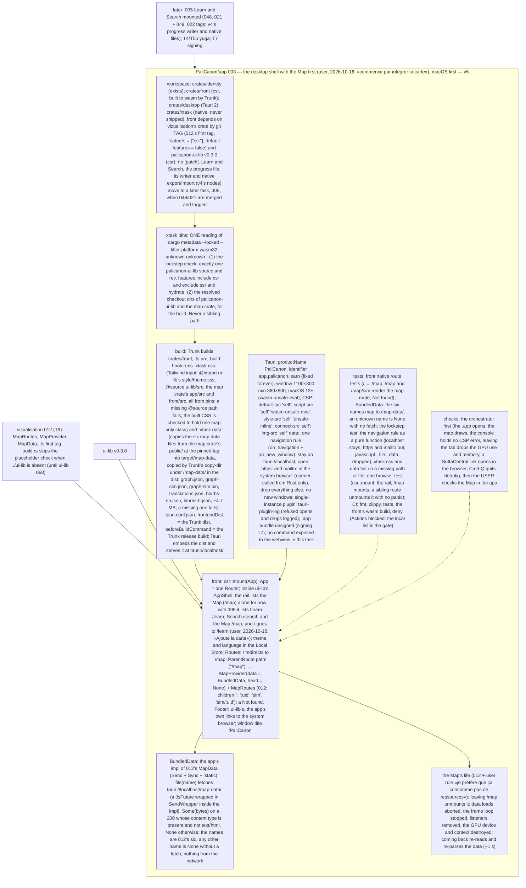

# 003 The desktop shell with the Map first

status: review · rank: 7 · level: hard · type: feature · request: app-001-palicanon-app T5a (user, 2026-10-16: "build l'app que je puisse checker"; "Oui, construis 048 + 021") · session: app-003-desktop-shell · after: [vizualisation 012 (its first tag)]

## Summary
Rank (rank.md): difficulty 7 (a new Tauri app around two fragments from two repositories, a persistent store with a write queue and failure states, native commands with atomic writes), impact 7 (the first build of the PaliCanon app the user checks and later ships) → 7.
What: the PaliCanon desktop app, macOS first: a client-side Leptos front (Learn under /learn, Search under /search, one ui-lib rail with the three services, the Map later), a Tauri shell, the progress file through native commands following learn-pali 048's app-store contract, export and import through native dialogs, external links in the system browser.
Requirements from the user's checks of the preview (2026-10-16): one rail, no double menu; Search on the new interface; the Map runs only on its tab (T9). Local search with yuga and bge-m3 int8 is T5b (after the yuga binary release, T4): this task ships a placeholder backend.

## Workflow

## Log
| Step | Result | Output |
| --- | --- | --- |
| Define | doing | orchestrator, 2026-10-16: session app-003-desktop-shell (design d185d447c3f9e4e v1, discussion d43790a2626d44b, process d8b678355433443); worktree /Users/lsh/projects/palicanon/wt/app003/app (feat/desktop-shell) |
| Define (consensus) | done | consensus agent (Opus), 3 rounds, v4: the latest progress kept in Rust (one mutex, a slot, RunEvent::Exit writes it), native export/import commands (no fs plugin, no webview permissions), a 4 MiB cap, one navigation rule (https/mailto out, nothing else), CSP with style-src 'unsafe-inline' and wasm-unsafe-eval (macOS 13+), single instance + progress.lock, crates/bridge for the messages, xtask pins (cargo metadata) for lockstep and CSS/assets paths; no Map in the rail until T9. User decision relayed: «Attendre yuga» — no user check at this task's end (the orchestrator checks the .app: no CSP error, an answer survives Cmd-Q, links open outside); the user's first check after T5b |
| Scope | changed | user, 2026-10-16: «commence par intégrer la carte» — v5: the shell mounts the Map first (vizualisation 012's contract, relayed 2026-10-16); Learn, Search and the progress writer (v4) move to 005; the user checks the Map at this task's end |
| Define (user) | done | 2026-10-16: «Sinon commence le draft», «macOS 13 minimum n'est pas un souci», «Ajoute la carte» (005's routes gain /map) — v6 validated |
| Plan | done | orchestrator: one Sonnet lane (new workspace, files new and coupled); the /map route mounts a stub until vizualisation 012's first tag, then the tag in one commit; builds under nice, -j 4 |
| Build | done | lane:shell (Sonnet): 4007c8a … b976001 (12 commits). .app at target/release/bundle/macos/PaliCanon.app (10.59 MiB, arm64, macOS 13+), /map a stub behind crates/front/src/map_mount.rs. Checks exit 0: fmt, leptosfmt, clippy native + front wasm32, tests 60 (desktop 7 + config 9, front 16, identity 5, xtask 23), doc, MSRV 1.88 check, deny, browser 1, trunk release (445 KB wasm). Opened: starts, single instance works; a probe build in the real WKWebView: / → /map, no CSP violation, window.open http/file null, location to http dropped. Found and fixed: Tauri answers a missing file with index.html 200 (BundledData refuses text/html) |
| Rulings | done | orchestrator: all accepted — xtask data staged in target/map-data then Trunk copy-dir; deny.toml (macOS + wasm32 graph, seven advisories ignored with reasons via tauri-utils and leptos, MPL-2.0 allowed per crate for cssparser, cssparser-macros, dtoa-short, option-ext, selectors: file-level copyleft, unmodified); CI written for macOS runners (not run: Actions blocked); the map crate layout <dir>/src and <dir>/public (confirmed by vizualisation's message); the spike's icons; the window built in Rust (create: false) for the navigation hooks; a small strings table; ui-lib version field for deny; the cargo xtask alias; the executable name palicanon-app-desktop |
| Review 1 | fail | reviewer: d5b581aa63a1b4f v1; deep 10182/10208/10221 (Δ and T in each batch, security proofs and build guards), sage 10244/10258/10272 (thin). Rulings in ### Round 2 — 2026-10-16
Voices: deep (10426, 10443), sage (10509, 10475). Rulings (orchestrator), taken in, done after the map mount:
- K1 (deep R2-2, urgent with the mount): the map's @source is the pinned checkout's app/src (vizualisation's message), not map/src.
- K2 (deep R1-1): tests/acl.rs asserts exactly one `main` window on the mock app (no second create).
- K3 (deep R1-2, R1-3): `handle_new_window` keeps Stayed apart from Dropped in the log; `on_new_window` uses `allow_new_window`'s answer; the two closures are tested through a small pure adapter.
- K4 (deep R1-5): `is_data` pins `(200, Some(""))` → not data.
- K5 (deep R1-6, Fix 1 open point): tests never write into the real ~/Library/Logs: the log plugin's target is configurable and tests use none (or a temp dir); Stayed logs at the level the plugin keeps, or the filter says why not.
- K6 (deep R2-3, R2-4, R2-5, T): run_metadata_with removes its temp dir on every failure (test); the old markers tautology goes; the NoTailwind path gets its own test; a failing `data` step at the process boundary exits non-zero (test); the Tailwind CLI pick sorts versions numerically (v4.10 after v4.9, test).
- Design wording (deep R1-5, R1-6, R2-1): v6's data node says "Some(bytes) on a 200 whose content type is present and not text/html"; the shell node names tauri-plugin-log; the build node says the six files are staged in target/map-data and copied by Trunk's copy-dir under /map-data/ (v7, viewer and here).
Ruled out: a back-navigation test (no history behaviour of ours); staging twice with a changed file set (the staging dir is rebuilt each run).

### Round 1; Fix round 1 |
| Fix 1 | done | lane:shell: e815163 J1 (ACL empty, mock-runtime IPC refused; live WKWebView probe: five invokes rejected by ACL), b7c5948 J2, b1e0077 J3 (log crate + tauri-plugin-log), 8f751f9 J4, 38781da J5, d8748c3 J6, 749b5e8 J7 (git+url?tag=…#40hex), dfa34d1 J8, d9966ec J9, 3b1e218 J10; plus 4b229dc (CI: a placeholder dist for generate_context!) and 658ae1e (xtask hang: sccache kept cargo's pipe open). Local list all exit 0: tests 92, browser 1, MSRV 1.88, deny, trunk release; .app rebuilt 10.88 MiB. Open, for later: tests write into the real ~/Library/Logs log; the v6 CSP blocks ipc:// (no command today; 005 decides connect-src ipc:) |
| Review 2 | fail | reviewer: d5b581aa63a1b4f v2; deep 10426/10443 (J1–J8, J10 answered, J9 partly; new Δ/T, mostly small), sage 10509/10475 (answered, thin). Rulings in ### Round 2; Fix round 2 after the map mount |

## Design
Viewer: app-003-desktop-shell/design (d185d447c3f9e4e), v7 — v6 validated by the user 2026-10-16; v7 = three wordings ruled at review 2.

## Lanes

## Reviews

### Round 1 — 2026-10-16
Voices: deep (10182, 10208, 10221), sage (10244, 10258, 10272: thin). Rulings (orchestrator), taken in:
- J1 no door (deep A1): the proof that the webview has no command is the generated ACL, not a filename grep: a test reads what tauri-build writes (capabilities/ACL under crates/desktop/gen or the resolved context) and asserts no permission is granted; plus a browser-side check in the probe build or a wasm test that `invoke("plugin:opener|open_url")` is rejected, if it can run headless (else say why).
- J2 CSP (deep A6): the CSP test is an allowlist: exactly the five directives with exactly v6's sources; any extra directive or source fails.
- J3 opener failure (deep A3): `decide` stays pure; a refused system open (Err) is logged distinctly from a designed Drop (log via the app's log, not only eprintln), test of the mapping.
- J4 second launch (deep A4): when `main` is absent at the second launch, the case is logged and ignored, by an explicit branch with a test.
- J5 `is_data` (deep B): a 200 is data only with a present content-type that is not text/html; `(200, None)` → not data (test updated).
- J6 navigation joins (deep B): a test runs the footer's real hrefs through `navigation::decide` (all OpenOutside); the browser test clicks the rail's /map link instead of pushing state.
- J7 pins (deep C1, C2): `check_source` applies to every pinned package (the map crate when added): a git source at an exact tag rev the lockfile records, not just `git+`; no path or registry source.
- J8 (deep C4): front/src comes from pins (the workspace member's manifest dir from cargo metadata), no literal path.
- J9 build guards (deep C): the xtask binary's exit code is tested (a failing css or data step → non-zero); the tautological markers test replaced by one asserting markers() reads pins.map; tailwind_binary's two failures and the cache walk tested; FILES asserted against the design's six literal names; DataError::Failed tested.
- J10 doc (deep B3): pins' doc says the lockstep check is over the wasm32 graph (native dev-dependencies may unify ssr there).
Ruled out: http://tauri.localhost (Windows/Android, later targets; noted in the navigation rule's doc instead); BundledData not wired and the dead map guards (by design until vizualisation 012's tag; the tag commit wires them and adds vizualisation to the private-deps action's repositories); distinct markers for the stub's children (the stub is replaced by MapRoutes).

## Merge
