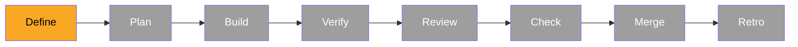
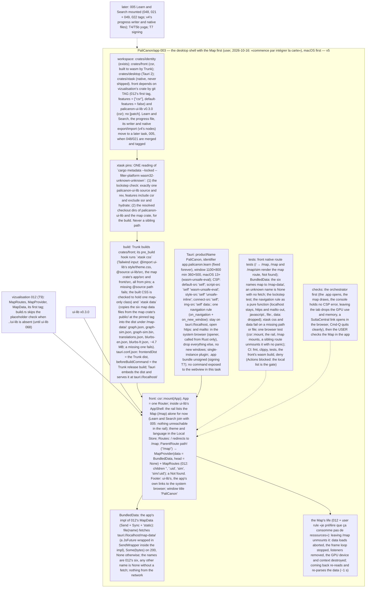

# 003 The desktop shell with the Map first

status: design · rank: 7 · level: hard · type: feature · request: app-001-palicanon-app T5a (user, 2026-10-16: "build l'app que je puisse checker"; "Oui, construis 048 + 021") · session: app-003-desktop-shell · after: [vizualisation 012 (its first tag)]

## Summary
Rank (rank.md): difficulty 7 (a new Tauri app around two fragments from two repositories, a persistent store with a write queue and failure states, native commands with atomic writes), impact 7 (the first build of the PaliCanon app the user checks and later ships) → 7.
What: the PaliCanon desktop app, macOS first: a client-side Leptos front (Learn under /learn, Search under /search, one ui-lib rail with the three services, the Map later), a Tauri shell, the progress file through native commands following learn-pali 048's app-store contract, export and import through native dialogs, external links in the system browser.
Requirements from the user's checks of the preview (2026-10-16): one rail, no double menu; Search on the new interface; the Map runs only on its tab (T9). Local search with yuga and bge-m3 int8 is T5b (after the yuga binary release, T4): this task ships a placeholder backend.

## Workflow

## Log
| Step | Result | Output |
| --- | --- | --- |
| Define | doing | orchestrator, 2026-10-16: session app-003-desktop-shell (design d185d447c3f9e4e v1, discussion d43790a2626d44b, process d8b678355433443); worktree /Users/lsh/projects/palicanon/wt/app003/app (feat/desktop-shell) |
| Define (consensus) | done | consensus agent (Opus), 3 rounds, v4: the latest progress kept in Rust (one mutex, a slot, RunEvent::Exit writes it), native export/import commands (no fs plugin, no webview permissions), a 4 MiB cap, one navigation rule (https/mailto out, nothing else), CSP with style-src 'unsafe-inline' and wasm-unsafe-eval (macOS 13+), single instance + progress.lock, crates/bridge for the messages, xtask pins (cargo metadata) for lockstep and CSS/assets paths; no Map in the rail until T9. User decision relayed: «Attendre yuga» — no user check at this task's end (the orchestrator checks the .app: no CSP error, an answer survives Cmd-Q, links open outside); the user's first check after T5b |
| Scope | changed | user, 2026-10-16: «commence par intégrer la carte» — v5: the shell mounts the Map first (vizualisation 012's contract, relayed 2026-10-16); Learn, Search and the progress writer (v4) move to 005; the user checks the Map at this task's end |

## Design
Viewer: app-003-desktop-shell/design (d185d447c3f9e4e), v5 — the Map first (user, 2026-10-16); v4 (Learn and Search) moves to task 005; awaiting the user's validation.

## Lanes

## Reviews

## Merge
