# 005 Learn, Search with local yuga, and the Map in one app

status: review · rank: 8 · level: hard · type: feature · request: app-001 T5a + T5b (user, 2026-10-16: «j'aimerais avoir le search et learn en plus de la map dans l'app»; «Fusionner sans dernier tour»; «Garde le modèle etc. en RAM») · session: app-005-learn-search-yuga · after: [003 (branched from feat/desktop-shell)]

## Summary
Rank (rank.md): difficulty 8 (two fragments mounted with a native progress writer and native files, a sidecar process with bundled store and model, the lockstep across three tags), impact 8 (the first app the user checks with all three services) → 8.
Design v2 = app 003's v4 (Learn and Search, detailed to and validated by the user, with «Ajoute la carte»), on top of 003 (the shell and the Map, v0.2.0), plus local yuga: yuga-sidecar v0.5.1 from anatta-rs/yuga-releases (SHA-256 pinned), the EN store and bge-m3 int8 bundled read only, the sidecar started at the first Search and kept with its model in memory until the app quits (user), words at once and meaning when the model is loaded.
Fragments by tag: learn-pali fragment-v0.1.0 (a19bfd6), search-front fragment-v0.1.0 (ce827b6), vizualisation v0.2.0; ui-lib v0.3.0.
The user checks the app at this task's end: Learn, Search searching locally, the Map, one rail.

## Workflow

## Log
| Step | Result | Output |
| --- | --- | --- |
| Define | done | orchestrator, 2026-10-16: session app-005-learn-search-yuga (design d91bc75bae0f94e v2, discussion df8190e62ba8f44, process d7b82a0cd58b941); the user's decisions quoted above; worktree /Users/lsh/projects/palicanon/wt/app005/app (feat/learn-search-yuga from feat/desktop-shell) |

## Design
Viewer: app-005-learn-search-yuga/design (d91bc75bae0f94e), v2.

```mermaid
flowchart TB
  subgraph t5a["PaliCanon/app 005 — Learn, Search with local yuga, and the Map in one app (T5a + T5b of app-001 v8), macOS first — v1 (from 003 v4, validated by the user with the Map added)"]
    crates["workspace: crates/identity (exists); crates/bridge (the wire, serde only, built native AND wasm: the commands' names, LoadAnswer = Text(raw) | Missing | Unreadable(msg), the status event Saved(seq) | Pending(seq) | Transient(seq) | NewerVersion(seq, raw), ImportAnswer = Text | Cancelled | Failed(msg), the caps: one shape read by both sides); crates/front (csr, built to wasm by Trunk); crates/desktop (Tauri 2, its commands, the writer; depends on learn_core by the SAME learn-pali tag, for State::from_json and State::VERSION); crates/xtask (native, never shipped). front depends on learn_pali (tag after 048 and 049, features csr) and search_front (tag after 021 and 022, features csr) by git TAG, and palicanon-ui-lib v0.3.1 (csr; 068 moved the placeholder check into palicanon-i18n-check, the fragments' build-dependency); no [patch]"]
    pins["xtask pins: ONE reading of `cargo metadata --locked --filter-platform wasm32-unknown-unknown`, serving both uses so they cannot disagree: (1) the lockstep check: exactly one palicanon-ui-lib source and rev, its features include csr and exclude ssr and hydrate; palicanon-i18n-check resolves to the same ui-lib rev; learn_core and learn_pali resolve to one rev; (2) the resolved checkout dirs of palicanon-ui-lib, learn_pali and search_front, for the build. Never a sibling path (F3: ../ui-lib does not exist under ~/.cargo/git/checkouts)"]
    build["build: Trunk builds crates/front; its pre_build hook runs `xtask css` (writes the Tailwind input: @import of ui-lib's style/theme.css, @source of ui-lib/src, learn_pali/src, search_front/src and front/src, all from pins; then the Tailwind CLI) and `xtask assets` (copies /lotus.png from learn_pali's app/public and /brand/*.svg from search_front's into the dist). tauri.conf.json: frontendDist = the Trunk dist, beforeBuildCommand = the Trunk release build; Tauri embeds the dist and serves it at tauri://localhost/, so the assets sit at the root. Nothing copied by hand into this repository. Later (follow-up, 048/021's side): each fragment ships its own CSS and assets"]
    front["front: the progress is loaded (progress_load) and the store built FIRST, then csr::mount(App); App = LearnProvider(app store, app files) above one Router; inside, ui-lib's AppShell: the rail lists Learn /learn, Search /search and the Map /map (user, 2026-10-16: «Ajoute la carte»); theme and language in the Local Store; Settings with LearnSettings; Routes: / redirects to /learn; ParentRoute /learn → LearnRoutes; ParentRoute /search → SearchProvider(the app's backend) + SearchRoutes; ParentRoute /map → MapProvider(BundledData, head None) + MapRoutes (from 003); a Not found. Footer: ui-lib's, the app's own links (to the system browser, see shell); no build badge sha (the app's version instead); window title 'PaliCanon'"]
    store["the app's ProgressStore (front, wasm), a mirror of the native writer: memory = learn_pali::classify(raw) for Text(raw), Empty for Missing, Load::Unreadable(msg) for Unreadable, and Load::Unreadable too when the progress_load call itself fails (the home's error and Reload); save(state) updates the memory at once, takes the next seq, sets Pending and calls progress_save(seq, json) fire-and-forget; refused locally while Unreadable or after NewerVersion (048's guard is the store's); status() follows the `progress-status` event by seq: an event whose seq is below the last one applied is ignored (Tauri does not promise delivery order), so neither an older Saved nor an older Transient overrides a newer verdict or a newer Pending; on NewerVersion(seq, raw), terminal (every event after it is ignored, whatever its seq), ONE synchronous run: unsaved = the memory before the swap (the latest save), memory = classify(raw), status = Failed(NewerVersion{unsaved}), then on_change; Transient(seq) = Failed(Transient), back to Saved when a later write lands. No timer and no page-hide hook in the webview (F4: WebKit freezes timers in a hidden window)"]
    files["the app's FileTransfer (048's contract): export(name, text) → export_file(name, text): the Rust side opens the save dialog (dialog plugin, Rust API) suggesting name reduced to a file name (Path::file_name, no separator, no NUL, '.json' forced), writes where the learner chose; a failure shown by a native message dialog. pick_import(on_text) → import_file(): the Rust side opens the open dialog (*.json), reads at most 4 MiB, answers Text (on_text(text)) | Cancelled (nothing called) | Failed (on_text(''), which the import validation refuses with its reason). The front never holds a path; no fs plugin; no dialog or fs permission granted to the webview"]
    cmds["desktop commands (Rust), the only ones the webview may call: progress_load() → LoadAnswer, I/O only, from <app data dir of app.palicanon.learn>/progress.json (the path is never from the front; Unreadable locks the writer shut for the session); progress_save(seq, text): text over 4 MiB refused, else put in ONE slot (a newer seq replaces it, an older one is dropped) and the writer woken; returns at once; export_file(name, text) (text ≤ 4 MiB); import_file()"]
    writer["the native writer: ONE mutex over its whole state (the slot, closed, the lock file held) and every write; the loop: take the mutex, re-check closed, take the slot; read the file on disk: a version newer than learn_core's State::VERSION → write nothing, emit NewerVersion(seq, raw), closed = true (later saves dropped); a file that does not parse → rename it to progress.json.corrupt-<time> first, so an Invalid file survives the learner's first save; write temp, fsync, rename, fsync the dir; emit Saved(seq); ANY I/O error on that path (the rename aside included) → emit Transient(seq) and keep the text in the slot unless a newer one is there (check and put under the same mutex), release the mutex; the retry waits (5 s, or the next save) with the mutex released. progress_save fills the slot under the same mutex, so it waits at most one write and a save during a write is written after it: file order = save order. progress_load runs on the same state: its Unreadable sets closed before the front can save. RunEvent::Exit (Cmd-Q through applicationWillTerminate, and the last window closing, read in tao 0.37 / tauri 2.12): takes the mutex (waiting at most for the in-flight write: Exit's own write already costs one fsync on the main thread, so the wait at most doubles it; Cmd-Q's time is measured in the .app check), writes the slot if filled and not closed, sets closed; whatever the writer thread held is then refused. An emit that fails (the webview gone) is logged, nothing else. One process: the single-instance plugin focuses the running app on a second launch, and the writer holds an exclusive lock on progress.lock in the app data dir for the session; a process that cannot take it answers Unreadable('PaliCanon is already open') and never writes. A crash or kill loses at most the in-flight and the slot's state"]
    search_be["the app's SearchBackend = local yuga (decision 2026-10-16, «Tout en local»; «bge-m3 compressé»): AppSearch (front) implements 021's trait over two commands, search(query) and search_status(); meaning() is a signal made once, false until the sidecar reports meaning true, then true; a search before the sidecar is ready answers Cold (the existing waking-up state, retry); an error answer maps to Failed; no network"]
    yuga["native search: the yuga-sidecar binary (anatta-rs/yuga-releases yuga-sidecar-v0.5.1, aarch64-apple-darwin, SHA-256 4fd89dc0…2165 pinned in the repo) fetched by `xtask yuga` and verified before use, bundled as Tauri externalBin; the EN store (gs://palicanon-app-assets/store/en-bge-m3-2026-10-02-b.tar.zst, pinned by SHA-256, unpacked at build) and the bge-m3 int8 model (Xenova/bge-m3 int8, five files, the SHA-256 constants yuga pins) bundled as resources, read only; the desktop spawns the sidecar with --store and --model from the Resources dir when Search is first opened, and KEEPS it running, the model in memory, until the app quits (user, 2026-10-16: «Garde le modèle etc. en RAM, on évite de reload à chaque fois»; ~2 GB while the app runs); a two-phase start: words served as soon as the store is open (~0.5 s), meaning() turns true when the model is loaded (~1 s later, in the background); one request in flight at a time (a mutex; JSON lines); a crash respawns once then answers Failed; the sidecar is killed on exit"]
    shell["Tauri: productName PaliCanon, identifier app.palicanon.learn (fixed forever); the main window is built in Rust setup (1100×800, min 360×500) so it carries: on_navigation allows tauri://localhost only (and the dev URL in debug builds); on_new_window (target=_blank, window.open) never opens a window; for both, an https: or mailto: URL is opened in the system browser through the opener's RUST API, any other scheme (file:, data:, javascript:, http:, a custom one) is dropped. Plugins: dialog and opener (called from Rust), single-instance. Capabilities: the progress, file and search commands (progress_load, progress_save, export_file, import_file, search, search_status) and core event listen, nothing else; CSP connect-src gains ipc: http://ipc.localhost (commands now exist) (no opener, dialog or fs permission for the webview). CSP: default-src 'self'; script-src 'self' 'wasm-unsafe-eval' (Tauri adds the hashes of the dist's inline bootstrap); style-src 'self' 'unsafe-inline' (Leptos sets whole style attributes, ui-lib theme.rs; the app renders no foreign HTML); img-src 'self' data:; connect-src ipc: http://ipc.localhost. macOS minimumSystemVersion 13.0 (wasm-unsafe-eval needs WebKit 16). macOS .app bundle, unsigned in this task (signing is T7)"]
    tests["tests: bridge (each type round-trips serde); the writer natively on a temp dir (a save during a write written after it, in order; Exit between the loop's wake-up and its write: exactly one write, the latest, none after Exit; a retry's put-back never replaces a newer save; a failed rename aside or fsync gives Transient and the retry; a second process without the lock answers Unreadable and writes nothing; Transient then the retry and then a newer save; exit while a retry waits: one write, the latest; exit after NewerVersion or Unreadable writes nothing; a newer file refused, nothing written, the event carries its raw text; a corrupt file moved aside on the first save, then the new one written; text over the cap refused); the front store over a fake bridge (seq: an old Saved or Transient delivered late changes nothing; a Saved delivered after NewerVersion changes nothing; a failed progress_load call gives Unreadable; the NewerVersion run swaps, sets status and calls on_change with no await; the guards); the navigation policy as a pure function (url → Allow | OpenOutside | Drop) tested natively, every scheme; export name reduction; front native route tests (/ → /learn, /learn and /search render, Not found, the rail has no Map entry); xtask pins on this Cargo.lock (lockstep holds, dirs exist); one browser test (csr::mount, the rail, a Learn answer reaches a fake progress_save). Merge gate, GitHub Actions minutes being exhausted: the local check list run and logged (fmt, leptosfmt, clippy, tests, rustdoc, the wasm build, deny, the .app build) and the .app checked by the orchestrator, not the user: no CSP violation in the console, an answer then Cmd-Q then relaunch keeps it, a suttacentral link opens in the browser and the window stays. the USER checks the app at this task's end: Learn, Search searching locally, the Map, one rail"]
  end
  learn["learn-pali 048 then 049 (the i18n-check crate; Learn fragment, learn_core; one tag on ui-lib v0.3.1)"]
  search["search-front 021 then 022 (the i18n-check crate; Search fragment; tag on ui-lib v0.3.1)"]
  ui["ui-lib v0.3.1 (068: palicanon-i18n-check)"]
  later["later: T7 signing and notarisation; the Map moves to vizualisation v0.2.0; French and Vietnamese stores (downloaded at first use, app-001)"]
  learn --> front
  learn --> cmds
  search --> front
  ui --> front
  crates --> front
  pins --> build --> front
  pins -.-> crates
  front --> store --> cmds
  front --> files --> cmds
  cmds --> writer
  writer -. progress-status event .-> store
  front --> search_be --> yuga
  shell --> front
  tests -.-> front
  later -.-> t5a
```

## Lanes

## Reviews

## Merge
