# 007 A public desktop release: a signed DMG and a stable download link

status: building · rank: 4 · level: standard · type: feat · session: app-007-public-release · request: the user, 2026-10-22 («app desktop on peut la mettre public ? avec un lien que je puisse la mettre sur le site vitrine ?») · after: [003, 005, 006]

## Summary
Rank: difficulty 4 (DMG bundle, Developer ID signing of the app and its sidecar, notarization and stapling, a release script, a GitHub Release with a stable asset name), impact 4 (the first public download; a Gatekeeper refusal on the showcase's link would be the first thing a visitor sees) → 4.
Decided so far: GitHub Releases on PaliCanon/app (public), a DMG for Apple silicon (macOS 13+), a stable link `releases/latest/download/PaliCanon-aarch64.dmg` for www, built and signed on the user's Mac by a script (the certificate and the notary profile live in the user's keychain; CI later). Needs from the user: a Developer ID Application certificate and `xcrun notarytool store-credentials palicanon-notary`. Open: publish an unsigned pre-release meanwhile, or wait for signing (orchestrator's recommendation: wait; a 'damaged app' dialog is a bad first look).

Decided 2026-10-24 (design v2): the script owns the signing (`codesign --force --timestamp --options runtime`, the sidecar then the app: Tauri signs without a timestamp); dual notarization through the Keychain profile (`xcrun notarytool --keychain-profile palicanon-notary`), the app stapled before the DMG is made from it, the DMG signed, notarized and stapled, the SHA-256 taken after; Gatekeeper assessed (`spctl`) on the DMG and on the app inside; the GitHub Release is a draft until `publish`, the last write; an existing tag or release aborts; the OAuth secret is gated in the built binary (through a file descriptor, never an argument) and the home path remapped (`--remap-path-prefix`, 609 occurrences before); `tauri.conf.json` is the version source and `Cargo.toml` must agree. Tag `app-v<version>`. The user (2026-10-24): the OAuth consent screen is « normalement prod » (to confirm in the console: API et services → Écran de consentement OAuth); the Yuga Binary License gets a clause that re-signing for platform distribution is not a modification (yuga-releases, the user's repository); Intel is not in this release (an x86_64 sidecar first, then a universal DMG: a later task); Windows and Linux need their own runners (later). The www link and copy (en/fr/vi, gemini's draft in the discussion thread) are a www task once the first release is published.

## Log
| Step | Result | Output |
| --- | --- | --- |
| Define | ✓ | session opened 2026-10-22, design v1, consensus round 1 (gemini, deep; sage 504); 2026-10-24: identity and notary profile present on the Mac, design v2 folds the voices (orchestrator, no agents), the user: OAuth consent screen « normalement prod » (to confirm in the console), the licence clause yes, Intel later |
| Build | ✓ | scripts/release.sh (build, publish), scripts/release-notes.md, scripts/release.test.sh: 114 checks against stubs, 111 with the real hdiutil/ditto/shasum/cp on a fake app; ci.yml jobs `scripts` (ubuntu) and `scripts-macos` |
| Review 1 | ✓ | @deep (15241): 8 findings, 8 tests; 6 taken, 2 closed with the code (below); round 2 on the fix diff |
| Review 2 | ✓ | @deep (15251) on the fix diff: 4 remarks; 2 taken (a gh failure other than not-found refuses; the check count pinned per mode: 119 stubs, 116 real tools), 1 closed with GitHub's rule (a draft creates no tag), 1 left as deep suggests. Last round at rank 4 |
| Merge | ✓ | 043f866 on main (squash of `feat/app-public-release`, tip c4f636f); the first run of the script follows on main |

## Design
Viewer: app-007-public-release/design, v2 (2026-10-24).

```mermaid
flowchart TB
  subgraph PRE["preflight: scripts/release.sh aborts before touching anything"]
    V0["version: crates/desktop/tauri.conf.json is the source; Cargo.toml workspace version must equal it; tag app-v<version> must exist nowhere (local, origin, gh release view fails); working tree clean, HEAD on main and pushed"]
    P1["identity: security find-identity -p codesigning lists one Developer ID Application; notary: xcrun notarytool history --keychain-profile palicanon-notary answers; OAuth: the Keychain item google-oauth-desktop-secret resolves (read inline, never printed)"]
    P0["bundle folder wiped (target/release/bundle), so no half-signed artefact of an aborted run is reused"]
  end
  B["build: cargo tauri build --bundles app --config tauri.bundle.conf.json --no-sign, RUSTFLAGS --remap-path-prefix $HOME=/build (609 home paths in today's binary); xtask yuga + dictionary + Trunk inside"]
  G1{"gate: the OAuth secret is in the built binary (grep -c -F against the Keychain value, inline); the sidecar is arm64; no /Users/ string"}
  STOP["abort, publish nothing"]:::stop
  S0["sign inside out, the script owns it: codesign --force --timestamp --options runtime -s <identity> on Contents/MacOS/yuga-sidecar, then on PaliCanon.app; codesign --verify --deep --strict; Timestamp present in codesign -dvv"]
  N1["notarize the app: ditto -c -k --keepParent → app.zip; xcrun notarytool submit --keychain-profile palicanon-notary --wait → Accepted (the log is fetched and kept in the scratch folder on Invalid)"]
  S1["xcrun stapler staple PaliCanon.app; stapler validate"]
  D["DMG from the STAPLED app only: hdiutil create -volname PaliCanon -srcfolder <staging: PaliCanon.app + Applications symlink> -format UDZO PaliCanon-<version>-aarch64.dmg"]
  C["codesign --timestamp -s <identity> the DMG; notarytool submit --wait → Accepted; stapler staple + validate the DMG"]
  V1["verify: spctl -a -t open --context context:primary-signature -vv DMG → Notarized Developer ID; hdiutil attach, spctl -a -t exec -vv on the mounted app, detach; shasum -a 256 AFTER the staple"]
  U["publish: gh release create app-v<version> --draft --title --notes-file (what is inside, 660 MiB why, Apple silicon macOS 13+, the Yuga Binary License non-commercial, the SHA-256); upload the versioned DMG then PaliCanon-aarch64.dmg (a copy); read both sizes back from the API"]
  P["gh release edit --draft=false --latest: the LAST write; only then does releases/latest/download/PaliCanon-aarch64.dmg resolve. The tag is created by the release on the pushed HEAD"]
  L["www (another task): the link https://github.com/PaliCanon/app/releases/latest/download/PaliCanon-aarch64.dmg and the one-paragraph copy en/fr/vi (Apple silicon only, the size and why, non-commercial engine; Intel and Windows/Linux later)"]
  T["tests, in CI: scripts/release.test.sh runs the script with fakes (a PATH of stubs for codesign, xcrun, hdiutil, gh, security, cargo): the preflight refusals (version mismatch, existing tag, dirty tree, no identity, no notary, no OAuth item), the gate on the binary, the order (staple before hdiutil, hash after staple, draft=false last), the stable asset uploaded after the versioned one"]
  V0 --> P1 --> P0 --> B --> G1
  G1 -->|missing| STOP
  G1 -->|all present| S0 --> N1 --> S1 --> D --> C --> V1 --> U --> P
  P -.-> L
  T -.-> PRE
  classDef stop fill:#fecaca
```

## Reviews
### Round 1 — 2026-10-24 (@deep, session entry `review`, message 15241)
1. The OAuth secret reaches no build step — closed with the code: `crates/desktop/build.rs` reads the Keychain item itself at compile time; the preflight only proves the item exists and the gate that it landed in the binary. Written in the script's header.
2. `publish` cannot repair a half-published release — TAKEN: `publish` is idempotent (a draft is published and made latest; a public release not latest is made latest; an already-latest one is left), a failed edit is read back rather than fatal, and the stable link is fetched (`curl -sIL`: 200 and `content-length` equal to the asset) before the script says published (T4).
3. A failed second upload traps the next run — TAKEN: a draft for the version is an aborted run's leftover, deleted and redone; only a published release refuses (T3).
4. The gate's scope — TAKEN in part: the main binary's architecture is checked (T2) and `Info.plist` scanned; the front's dist is embedded in the binary by Tauri (already scanned); the sidecar carries 55 paths of its author's machine, a yuga-releases follow-up (`--remap-path-prefix` at its build), reported, not refused.
5. No trap around the mount — TAKEN: an EXIT trap detaches a mounted dmg; the mountpoint is under the scratch (T7).
6. The stable copy is not re-hashed — TAKEN: its SHA-256 must equal the versioned dmg's (T6, a short copy refuses).
7. Δ2, the version read by `sed` — TAKEN: the `[workspace.package]` version is parsed by section; `crates/desktop/Cargo.toml` must say `version.workspace = true`; no `head -1` under `pipefail`.
8. Stubs prove the stubs' opinion — TAKEN: the suite runs on macOS with the real `hdiutil`, `ditto`, `shasum` and `cp` on a fake app (`RELEASE_TEST_REAL_TOOLS=1`, CI job `scripts-macos`, T8); the real dmg is created, attached and detached in the test.
### Round 2 — 2026-10-25 (@deep, 15251, the fix diff)
1. The draft branch is dead code behind the tag checks — closed with GitHub's rule: a draft release creates no tag until it is published, so a leftover draft passes `git tag` and `ls-remote` and is found by `gh release view`; the test of a published release whose tag is missing (no stub tag, `isDraft: false`) refuses as before.
2. Any `gh` failure read as "no release" — TAKEN: only "not found" means no release; another failure refuses naming gh (test `STUB_GH_DOWN`).
3. The macOS job's smaller count hides a regression of the stub-only checks — TAKEN: the suite asserts its count per mode (119 with stubs, 116 with the real tools).
4. Tab or CRLF in the TOML fails closed — left, as deep suggests (blocks a release, never ships a wrong one).

T1 (the secret only in Resources, a path in Resources/*.js): closed with the code, the dist is in the binary, not in Resources. T5 TAKEN (`APPLE_SIGNING_IDENTITY` exported changes nothing: `--no-sign`, three codesign calls).

## Retro
