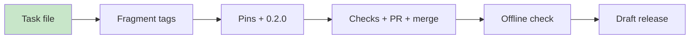

# 014 The desktop app 0.2.0 with the fragments of 2026-11-15

status: building · rank: 4 · level: simple · type: build · request: the user, 2026-11-15 (« et l'app est prête ? elle marche bien en offline ? » … « vas y ») · after: [010, 013]
worktree: /Users/lsh/projects/palicanon/wt/app-014/app (branch `build/app-fragments-2026-11-15`)

## Summary
Rank: difficulty 3 (three fragment tags, four pin bumps and the lock, the version in two files, an offline check of the bundle and a signed release run; no new code expected), impact 5 (the public download of every desktop user). Light path: no viewer design, no review; the release stops at a draft until the user has tested the DMG with the network off.

The app embeds Learn at `fragment-v0.5.2`, Search at `fragment-v0.1.3` and the map at `fragment-v0.2.6`, all on ui-lib v0.4.5 (010). Since then each service's main moved:

- **Learn** (learn-pali 02ff09d): the size of due review sessions is chosen (8baef6f), extra sessions vary and the card layout is simpler (4679cc6), rusqlite 0.41; the rest is server side (logs, healthz, robots/sitemap, Cloud Run).
- **Search** (search-front 5e2fde1): the pending opacity clears once results arrive (644c1d2, 667481e); the legal pages move to palicanon.app (477f2e9); the rest is server side.
- **Map** (vizualisation 50e3971): the footer pages move to palicanon.app (e603ab5); the rest is server side.

All three mains pin ui-lib v0.4.5, so the app keeps one ui-lib. New tags: learn-pali `fragment-v0.5.3`, search-front `fragment-v0.1.4`, vizualisation `fragment-v0.2.7`, annotated, on each main's head (no version bump: the fragment crates stay 0.1.0, as for the earlier tags). No `fragment-*` tag starts a deploy: every `deploy.yml` triggers on `v*` tags only.

The app becomes 0.2.0 (`Cargo.toml` and `crates/desktop/tauri.conf.json`), released for macOS on Apple silicon by `scripts/release.sh build` (signed, notarized, draft release). `release.sh publish` waits for the user's offline test.

**Not in 0.2.0: Windows and Linux.** Their bundles need yuga's sidecar for `x86_64-unknown-linux-gnu` and `x86_64-pc-windows-msvc`; `yuga-sidecar-v0.5.2` on anatta-rs/yuga-releases holds only `aarch64-apple-darwin`, and xtask's `TARGETS` has only macOS, so `release-desktop.yml` refuses both platforms. yuga's Actions still do not start ("recent account payments have failed", last run 2026-10-30), the block 013 recorded. Follow-up (orchestrator ruling 2026-11-15): once anatta-rs billing is fixed, run yuga's `sidecar release` workflow, publish the archives, add the two `TARGETS` with their digests, then `gh workflow run release-desktop.yml -f tag=app-v0.2.0`.

## Lanes
| Lane | Slice | Files | Model |
| --- | --- | --- | --- |
| none | pins, version and README by the lead (no code) | `Cargo.toml`, `Cargo.lock`, `crates/desktop/tauri.conf.json`, `README.md` | — |

## Workflow

## Log
| Step | Result | Output |
| --- | --- | --- |
| Task file | done | rank 4, light path; Windows/Linux blocked (no sidecar, anatta-rs billing), follow-up recorded; process posts in this Log (no viewer running) |
| Fragment tags | done | learn-pali `fragment-v0.5.3` (02ff09d), search-front `fragment-v0.1.4` (5e2fde1), vizualisation `fragment-v0.2.7` (50e3971), annotated, pushed; no workflow ran on them (deploys trigger on `v*`); the three mains on ui-lib v0.4.5 |
| Build | done | pins and lock (one ui-lib, v0.4.5), 0.2.0 in both files, README; one break: `xtask css` refused the build, the map marker `.border-collapse` left the map with e603ab5 (translators table on palicanon.app). Fixed to `.touch-none` (the engine canvas), guarded by `the_map_marker_is_a_class_only_the_pinned_map_sources_use`, red first (lane css-marker, Sonnet). Local matrix: fmt 0, leptosfmt 0, clippy host 0, wasm 0, desktop 0, xtask data 0, test 242 (0 in an isolated target dir; a bridge doctest failed twice in the shared `~/.cache/cargo-target` while another session built in it), doc 0, msrv 1.91 0, deny 0, release/attach script tests 0, trunk 0 |
| Offline check | partial | the bundle (0.2.0, 727 MiB) holds `yuga-sidecar`, the store, the model, the three dictionary dbs, and the six map-data files in the embedded front. With all network denied (`sandbox-exec`, `(deny network*)`, checked by a curl refused), the bundled sidecar answers status (`ready`, `meaning: true`) and returns hits in words, meaning and both modes. Learn's deck is compiled in (`include_str!`). Not verified headless: the UI with Wi-Fi off (the WebView runs outside the sandbox); the user tests it |

Follow-up seen in the lane: `UI_LIB_MARKER` (`.min-h-screen`) is also in a map test string (vizualisation `components/site_footer.rs`), so it no longer proves that ui-lib's `src` was read. The build is not broken; a ui-lib-only class is a later fix.
